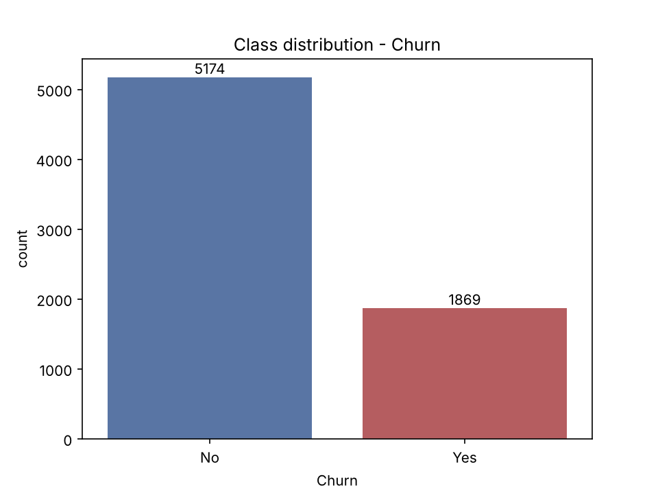
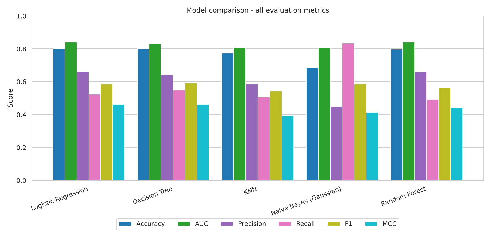
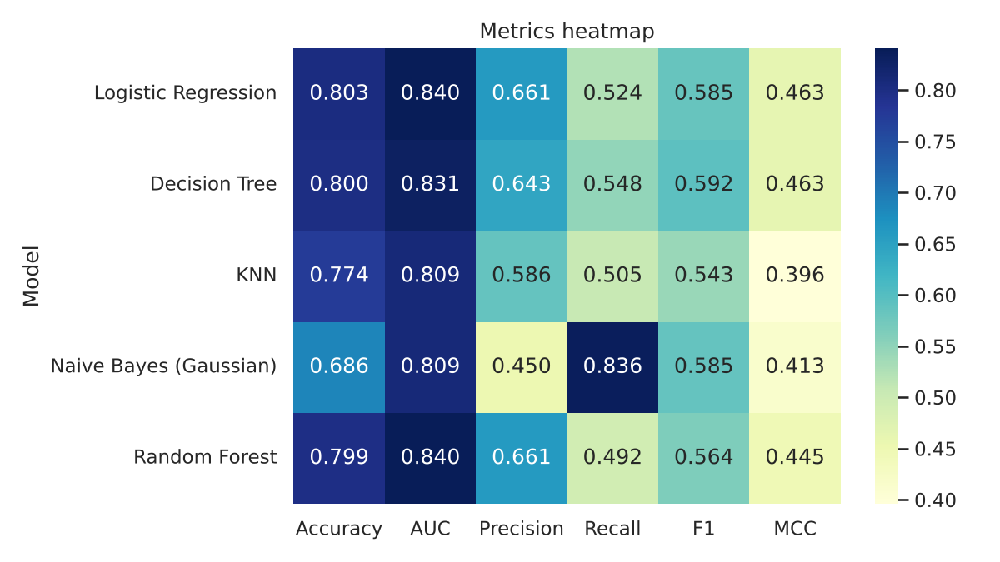
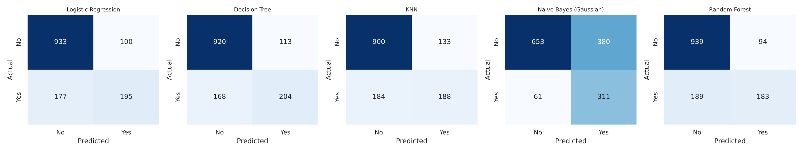

# Telco Customer Churn Prediction - ML Assignment 2

M.Tech (AIML/DSE) - Machine Learning | BITS Pilani WILP | BITS ID: 2026ct05070

Five classification models (Logistic Regression, Decision Tree, KNN, Naive Bayes, Random Forest) compared on the Telco Customer Churn dataset.


## 1. Problem Statement

Customer churn (customers leaving the service) is costly for telecom providers, since retaining
a customer is cheaper than acquiring a new one. The goal of this project is to build and compare
five classification models that predict whether a customer will **churn (Yes/No)** from their
account, service and billing information. The models are compared on Accuracy, AUC, Precision,
Recall, F1 and Matthews Correlation Coefficient (MCC).

## 2. Dataset Description  [1 mark]

- **Source:** Telco Customer Churn (IBM sample data), Kaggle - https://www.kaggle.com/datasets/blastchar/telco-customer-churn
- **Why this dataset:** Customer churn is a common, real business problem for telecom companies, so the prediction has a clear practical use. The data has a good mix of numeric and categorical features, a hidden data-quality issue (blank `TotalCharges` values) that must be handled, and an imbalanced target (about 27% churn), which makes metrics beyond accuracy important.
- **Size:** 7,043 rows x 21 columns (20 features + target) - meets the 12-feature / 1,000-instance requirement.
- **Target variable:** `Churn` (Yes = customer left, No = stayed) - binary classification.
- **Feature types:**
  - Numeric: `tenure`, `MonthlyCharges`, `TotalCharges`
  - Binary (0/1): `SeniorCitizen`
  - Categorical (15): `gender`, `Partner`, `Dependents`, `PhoneService`, `MultipleLines`, `InternetService`, `OnlineSecurity`, `OnlineBackup`, `DeviceProtection`, `TechSupport`, `StreamingTV`, `StreamingMovies`, `Contract`, `PaperlessBilling`, `PaymentMethod`
  - Identifier (dropped): `customerID`
- **Class distribution:** No = 5,174 (73.46 %), Yes = 1,869 (26.54 %). The target is imbalanced (about 2.77 : 1), so accuracy alone is misleading and AUC, F1 and MCC are also considered.




### Preprocessing

| Step | What was done |
|---|---|
| Missing values | `TotalCharges` contains blank strings (new customers with `tenure = 0`). These were converted to `NaN` and imputed with the **median** (fitted on train only). Categorical columns use a most-frequent imputer as a safeguard. |
| Duplicates | Duplicate rows (after removing `customerID`) were detected and dropped. 22 duplicate rows removed (7,043 -> 7,021 rows). |
| Encoding | One-Hot Encoding for categorical features (`handle_unknown="ignore"`); target mapped Yes -> 1, No -> 0. |
| Scaling | `StandardScaler` on `tenure`, `MonthlyCharges`, `TotalCharges` (needed for Logistic Regression and KNN). |
| Split | 80:20 train-test split, **stratified** on `Churn`, `random_state=42`. |
| Leakage control | All preprocessing sits inside a scikit-learn `Pipeline`/`ColumnTransformer`, so it is fitted **only on the training data** and then applied to the test data. |

## 3. GitHub Repository Link  [2 marks]

https://github.com/2026ct05070/ML_assignment_2

Repository structure:

```
ML_assignment_2/
├── README.md
├── requirements.txt
├── test_data.csv                  # 20% hold-out test set used for evaluation
├── model/
│   └── ML_Assignment2.ipynb       # full code: EDA, preprocessing, 5 models, metrics, charts
├── data/
│   └── WA_Fn-UseC_-Telco-Customer-Churn.csv   # original dataset (Kaggle)
└── outputs/
    ├── class_distribution.png
    ├── metrics_bar_chart.png
    ├── metrics_heatmap.png
    └── confusion_matrices.png
```

### How to run

1. Install the requirements: `pip install -r requirements.txt`
2. Open `model/ML_Assignment2.ipynb` in Jupyter Notebook, JupyterLab or Google Colab.
3. Put `data/WA_Fn-UseC_-Telco-Customer-Churn.csv` next to the notebook (or upload it when the notebook asks for the file; in Colab a file picker appears).
4. Run all cells (Kernel/Runtime -> Run all). The comparison table and charts are produced in the notebook, and `test_data.csv` is written to the working folder.

## 4. Models Used  [5 marks]

All five models were trained on the **same** preprocessed training set and evaluated on the **same** test set.

| # | Model | Configuration |
|---|---|---|
| 1 | Logistic Regression | `max_iter=1000`, default L2 regularisation |
| 2 | Decision Tree | `max_depth=6`, `min_samples_leaf=20` |
| 3 | K-Nearest Neighbors | `n_neighbors=11` (on scaled features) |
| 4 | Naive Bayes | `GaussianNB` (default) |
| 5 | Random Forest (ensemble) | `n_estimators=300`, `max_depth=10`, `min_samples_leaf=5` |

All with `random_state=42` where applicable. The positive class is `Churn = Yes`.

### Comparison table

| Model | Accuracy | AUC | Precision | Recall | F1 | MCC |
|---|---|---|---|---|---|---|
| Logistic Regression | 0.8028 | 0.8403 | 0.661 | 0.5242 | 0.5847 | 0.463 |
| Decision Tree | 0.8 | 0.8308 | 0.6435 | 0.5484 | 0.5922 | 0.4634 |
| KNN | 0.7744 | 0.8089 | 0.5857 | 0.5054 | 0.5426 | 0.3958 |
| Naive Bayes (Gaussian) | 0.6861 | 0.8092 | 0.4501 | 0.836 | 0.5851 | 0.4132 |
| Random Forest | 0.7986 | 0.8395 | 0.6606 | 0.4919 | 0.5639 | 0.4446 |

### Visualisation of metrics  [2 marks]







### Observations on model performance  [3 marks]

| Model | Observations |
|---|---|
| Logistic Regression | Best overall balance: highest accuracy (0.803) and AUC (0.840) with the best precision (0.661, tied with Random Forest). It catches 195 of 372 churners (recall 0.524). Churn here is driven mostly by tenure, contract type and monthly charges, which a linear model captures well, and it is fast and interpretable. |
| Decision Tree | Accuracy (0.800) and AUC (0.831) are very close to Logistic Regression, and it has the best F1 (0.592) and MCC (0.463). Limiting depth (6) and leaf size (20) kept it from overfitting. Its lower AUC means its probability ranking is a bit coarser, since a tree outputs only a few distinct probabilities. |
| KNN | Weakest of the balanced models: lowest accuracy (0.774), AUC (0.809) and MCC (0.396). After one-hot encoding there are about 40 mostly binary dimensions, so distances are less meaningful, and the majority class dominates neighbourhoods. |
| Naive Bayes (Gaussian) | Behaves very differently: highest recall (0.836, 311 of 372 churners found) but lowest precision (0.450) and accuracy (0.686), with 380 false alarms. Its AUC (0.809) is not far behind the others, so its ranking is fine but its probabilities are poorly calibrated. Gaussian assumptions on one-hot features and strongly correlated features (e.g. TotalCharges vs tenure) push it to over-predict churn. It would suit a campaign where missing a churner costs far more than a wasted offer. |
| Random Forest | Second-best AUC (0.840, almost equal to Logistic Regression) and the highest TN count, but recall is the lowest (0.492) and F1 is only 0.564. On imbalanced data it favours the majority class at the default 0.5 threshold. A lower decision threshold or `class_weight="balanced"` would likely raise recall. |

**Overall Winner:** Logistic Regression is the best all-round model (accuracy, AUC, precision), with Random Forest and Decision Tree close behind. The ensemble did not clearly beat the simple linear model, which suggests the signal in this dataset is mostly linear and simple. Because only 26.5% of customers churn, accuracy alone is misleading (always predicting "No" would score about 73.5%), so AUC, F1 and MCC are the better yardsticks. Which model is "best" depends on the business cost: if retaining a churner is worth more than a wasted offer, Naive Bayes's high recall is attractive; if offers are expensive, Logistic Regression or Random Forest, with higher precision, fit better.

## 5. Execution Screenshot


[Screenshot 2026-11-24 005328.pdf](https://github.com/user-attachments/files/35295740/Screenshot.2026-11-24.005328.pdf)

Screenshots of the notebook executed on the BITS Virtual Lab (BITS ID 2026ct05070) are included in the submitted PDF.
